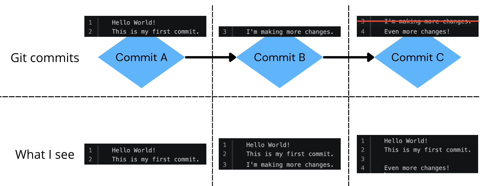
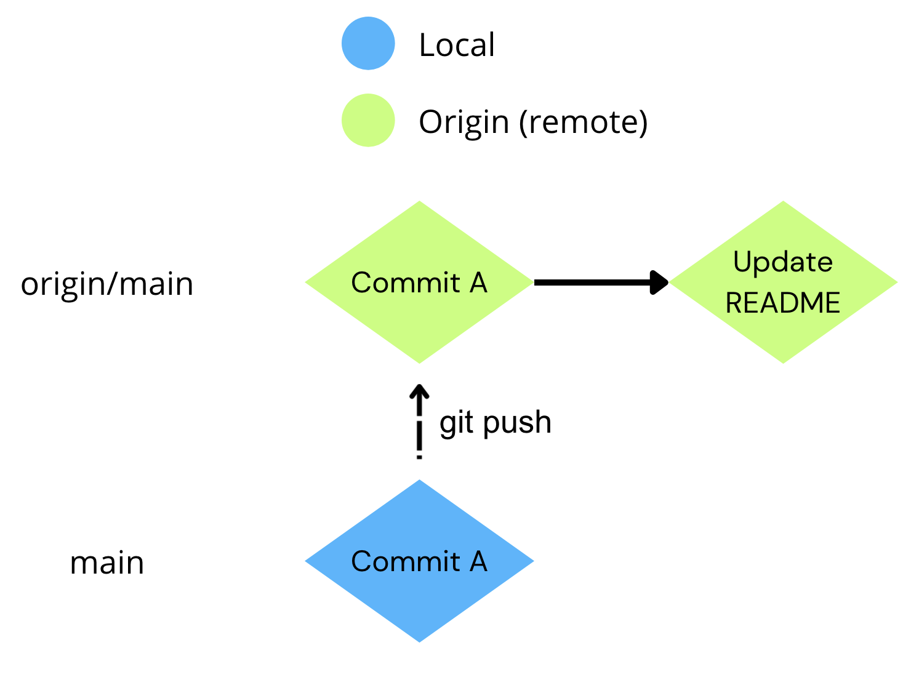
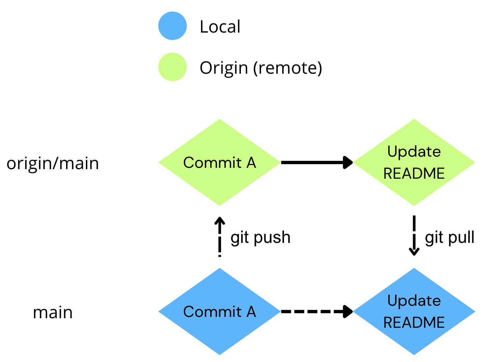
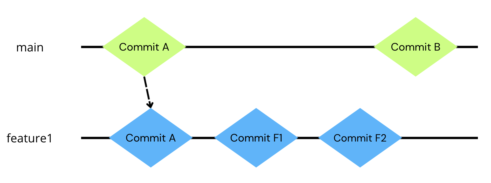
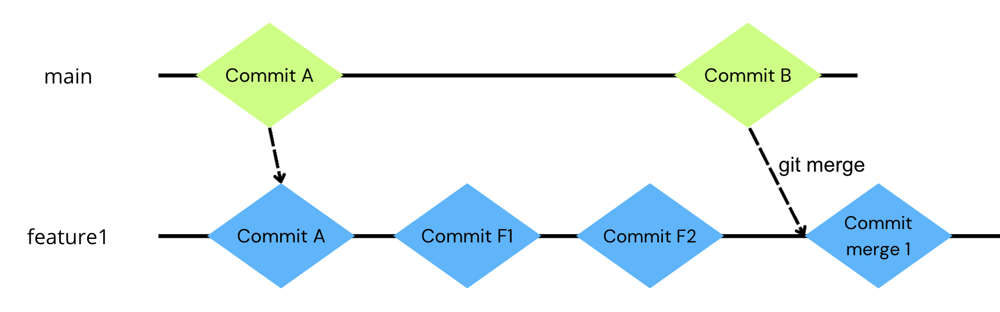
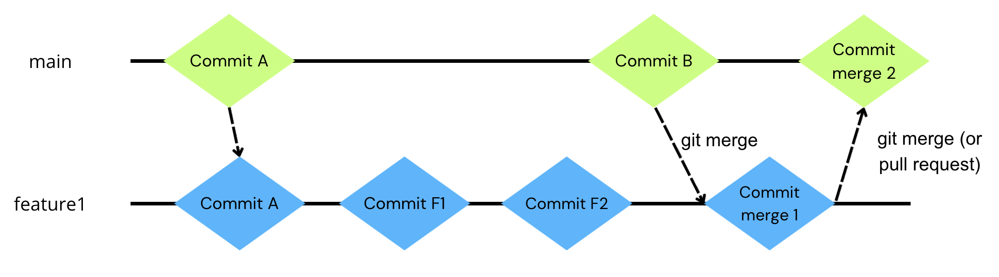

# GITHUB STEP BY STEP

## Creating new repository and syncing
For creating a new repository, whether you're starting from scratch or when you already have code in a local folder, first create a blank repository online. Then, in your terminal:

```bash
# first set up your name and email so git knows who is making changes
# (this is not used for Github authentication)

git config --global user.name "Your Name"
git config --global user.email "you@example.com"

# go to your repository's root directory
cd /path/to/your/repository/

git init
```

If you are joining a directory that already exists on github and has files:

```bash
git clone https://github.com/SomeGithubUser/TheirRepository.git

# If their repository uses external submodules that are necessary to run the program, use:
git --recurse-submodules clone https://github.com/SomeGithubUser/TheirRepository.git 
```

 Create a .gitignore file. In it, include all the folders or files that you don't want to synchronize, for example, all build or executable files, or the results of simulations that create heavy files or hundreds of them. Example .gitignore file:

```
/build/ # ignores the build folder on the repository's root directory
build/  # ignores every build folder anywhere in the project (inside other folders too)
/model/results/ # ignores the results from the model
*.exe   # ignores every file that ends in .exe
```

```bash
# any new changes that you make are recorded in history with these commands
git add .
git commit -m "message"

# these only need to be used once (or when you create a new branch)
git branch -M main
git remote add origin https://github.com/YOUR_USERNAME/YOUR_REPO.git

# synchronize the repository with your local history
git push -u origin main # The -u origin main part is necessary when the branch does not yet exist in the remote. It lets git know that
                        # from now on, origin/main
```

The last step might fail if you don't have set up an ssh key. Alternatively, you can use Visual Studio Code's Github authentication to log into Github and authorize the push.

To create an ssh key:

```bash
ssh-keygen -t ed25519 -C "your_email@example.com"
```

Then look for the directory where it was created, usually in your user folder: ~/.ssh (macos), or users/myusername/.ssh (windows). Copy the contents of the public key "id_ed25519.pub". On Github.com, on settings, go to SSH and GPG keys and create a new ssh key. Paste the public key.

If you have accidentally tracked an unwanted file and commited, you can solve it in the next commit.

```bash
git rm --cached "program.exe" # This doesn't remove the file from your computer
git rm -r --cached "build/" # recursive, to untrack an entire folder and its content
git commit -m "Stop tracking .exe files and update .gitignore"
```

Example for first commits.

```bash
git add .
git commit -m "first commit"

# make changes

git add .
git commit -m "second commit"

# make more changes

git add .
git commit -m "third commit"
```



## Synchronizing with origin (remote)

Two commands are crucial for keeping your local files up to date.

### Fetch

This only updates your local information about the remote repository. Do this frequently.

```bash
git fetch
```

You can check if there have been changes in the remote repository with

```bash
git status
# or
git diff main origin/main
```

### Pull

This will run ```git fetch``` and then merge the new commits from the remote branch into your local branch. Do this when you haven't made important changes in local before pulling changes other people or you have made in remote.

```bash
git pull
```

For example, if you have changed the README.md through Github.com on the main branch, and you're on the same main branch in local, use this to bring the changes of the README.md into your computer. Merging is usually complicated when changes are made across the repository and conflicts can arise.

```bash
# 1. commit your changes in your repository and push them to the remote
git commit -m "Commit A"
git push

# 2. Edit the README.md from Github.com
```



```bash
# 3. synchronize the changes in local
git pull
```



Now both remote and local have two commits: "Commit A" and "Update README".

## ✨✨✨Working with others and avoiding violence (best practices) ✨✨✨✨

Every person working in parallel for large codebases should create a new branch for each big feature, instead of directly working and committing changes to the main branch.

First, create your branch.

```bash
git checkout -b feature1 # this creates the branch and moves you into it

# do changes

git add .
git commit -m "commit f1"

# do more changes

git add .
git commit -m "commit f2"
```



Someone else has made changes to main while we were working on our branch. We need to include these changes into our feature1 branch, to make sure things don't break.

```bash
git pull # get information about the remote repository (and other people's changes) and update your
         # branch to its latest commit from remote, if there are any changes
git checkout feature1 # only necessary if you weren't in your branch

git merge origin/main # this does NOT change origin/main. it brings the changes from
                      # the main branch into the branch you're in (feature1)
```

This step may create **Merge Conflicts**, which happens when the changes that someone has made in main contradict your changes. You will need to decide whether you will keep your own changes or other people's (or, if both options break the program, write the fix).

Merge conflicts are more conveniently resolved using your IDE's tools, not in your terminal.

Very often, a merge will break your program **EVEN WITHOUT MERGE CONFLICTS**, whenever a change another person makes in the code doesn't contradict your own changes but they change the way the program works in a way you didn't expect. **RUN TESTS AND CHECKS**

You can repeat this step as main receives changes from other developers, so that your branch is up to date with what others are doing. If not, you will need to deal with all the changes later.




Finally, when your feature works and is ready to be implemented to the main branch, do a merge in the same way but from main.

```bash
git checkout main
git pull # bring the latest changes from the remote into local so you don't miss commits

git merge feature1 # This CHANGES main. Make sure everything works before pushing

git push
```

If your previous merge of main into feature1 was successful and you solved all the conflicts, there shouldn't be any problems or conflicts in this step.

If you are not the owner of the repository, or your changes need supervision, use a pull request on github (it is the same as a merge, but will allow others to review the changes before the owner finally approves the merge).

The result is:



## Forking

If you are not an owner or do not have editing privileges on the github repository, but you want to contribute to it, you have to option to **fork** the repository. This is a feature that is also possible in other repository websites, such as GitLab.

Forking copies the entirety of someone's repository and lets you own the copy. You can change that copy however you like. To contribute to the original, create a branch in your copy (feature1, for example), and then open a pull request in the main branch of the original repository that will bring your feature1 branch in. The owners will review the changes and accept or reject them.


# CMAKE STEP BY STEP

CMake lets you move away from long terminal comminds for compiling and dependency headaches. This makes code difficult to reproduce. While this is okay for a simple test program:

```bash
g++ main.cpp random.cpp -o main -O3 -I libraries/
```

As you add more and more libraries, it will become a headache.

```bash
# Dear referee. This is how you build the code for reproducibility

# Make sure you have installed g++, git, GSL, OpenMP and eigen and substitute the paths with your own.

git clone https://github.com/PromisingScientist/ArticleCodeFinalv4final2.git
cd ArticleCodeFinalv4final2

g++-14 -std=c++17 -O3 -DNDEBUG -Wall -Wextra -I libraries/ -I /path/to/eigen-3.4.0 \
    -I /opt/homebrew/opt/gsl/include src/main.cpp src/solver.cpp -L /opt/homebrew/opt/gsl/lib \
    -lgsl -lgslcblas -lm -o simulation
    

./simulation

# good luck <3
```

This is hard to reproduce because every person will have to download or even build all the libraries on their own and link their paths, which are different for every person or OS. **The referees are going to be in a bad mood while reviewing your paper**.

Additionally, every time you make a change in your code everything will need to be recompiled, including all the external library code you use (for example, about 50000 lines of Eigen).

## What is CMake

CMake is not a compiler, but a program that will generate a set of instructions to call the compiler and build your code. All these instructions are inside files called "CMakeLists.txt" that other users shouldn't care about. All they need to do should look something like this:  

```bash

# Dear referee. This is how you build the code for reproducibility
# Make sure your system has installed git, cmake and GSL

git clone https://github.com/PromisingScientist/CleanCodebase.git
cd CleanCodebase/build/
cmake ..
cmake --build .

./simulation

```
You can even create a script that runs some of these commands with whatever flags you choose.

## Bare minimum for getting a program to run

Suppose you have a simple program to compile, that consists of a main.cpp file and a header.

```cmake
cmake_minimum_required(VERSION 3.10)

# name the project
# this will be used as the target name for the executable
project(HelloWorld)

set(CMAKE_CXX_STANDARD 17)
set(CMAKE_CXX_STANDARD_REQUIRED ON)

# export compile commands for tools like clangd, optional
set(CMAKE_EXPORT_COMPILE_COMMANDS ON)

# equivalent to -I, let's the compiler know where to look for headers
include_directories(src)

# this is what we want to compile into an executable
add_executable(hello_world src/main.cpp)
```

Now, to build, ALWAYS create a build/ folder so all the files that CMake creates are kept in one place and keep that location from being synchronized by git, through the .gitignore file.

```bash
cmake .. # Runs the CMake code, sets up all the helper files and configurations, looks for libraries, sources, etc
cmake --build . # Actually compiles the program 

./hello_world
```

These are the minimal steps. CMake also supports standard configurations for Debug and Release modes, you may add a flag either on the first or second step, depending on what works with your compiler.
```bash
cmake .. -DCMAKE_BUILD_TYPE=Release # including the release flag here works for gcc or clang and compilers that support only one configuration per build
cmake --build . --config Release -j # this flag works for compilers that support multiple configurations like visual studio or xcode.
```

